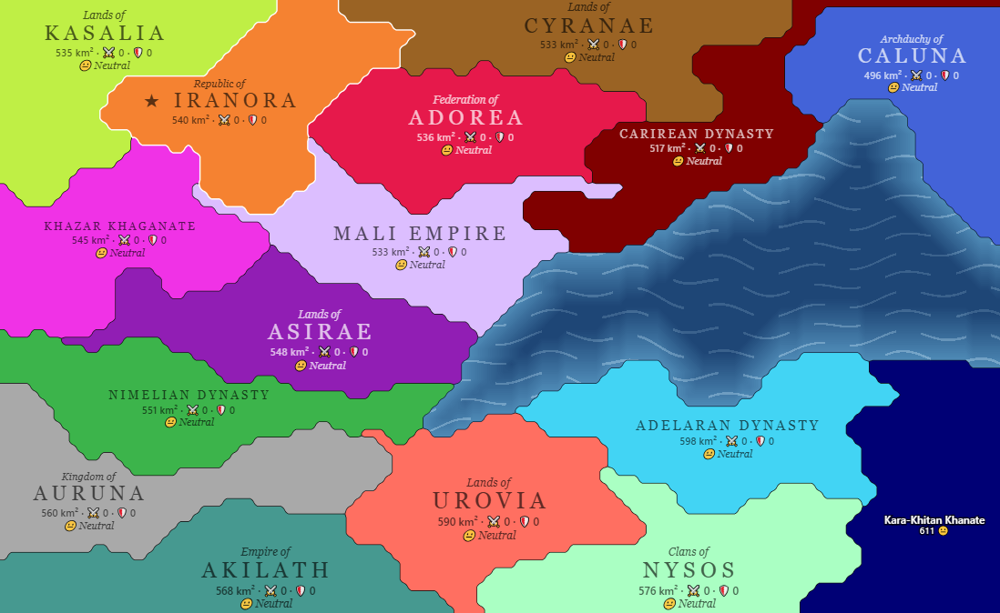

# Epic Battle: Sovereignty

*A turn-based game of war and economy on a continent split between many crowns.*

**[▶ Play now](https://rkistaps.github.io/epic-battle-sovereignty/)**

## The Lore

Before the first year was counted, the continent had one ruler: the Sovereign. Nobody remembers the face. Everyone remembers the law. There was one crown, one treasury and one road, and every road led to the throne.

Then the Sovereign died, with no heir and no will. The court split along old family lines. Governors closed their gates. Within one winter the single realm had broken into a patchwork of states, each holding the same measure of land and the same stores of grain, timber and iron. Each was led by someone who believed they alone should inherit the throne.

So begins the **First Year**.

They are Empires and Republics, Khaganates and Dynasties, Federations and Clans. Some came from Roman stock and value roads and learning. Some descend from Vikings and live off forest and sea. Some, like the Numidians, have learned that a good wall is worth more than a long spear. Their leaders differ too. A Farmer-king fills the granaries. A Warrior-queen trains her armies. A Scientist-prince believes the war will be won in the academy. A Defender keeps every gate manned and every border watched.

The land shapes them as much as blood does. Mountain holds are hard to take and rich in ore. Plains feed many but have nowhere to hide. Island states trade on the tide, and volcanic states draw strength from fire and ash. Lakes and rivers cut the continent into narrow passes where a few hundred pikemen can stop an army.

On scattered hills stand the **Wonders** of the old realm: the Great Forge, the Sacred Grove, the Arena of Champions, the Great Lighthouse and others. Whoever holds the ground beneath one inherits its power, so the borders around them are rarely quiet.

Every year, every ruler makes the same choices at once. Fund scholars, or buy swords? Sell the grain surplus, or store it against famine? Make peace with a neighbor, or strike while their general is away? Trust builds slowly along peaceful borders and breaks overnight. A state that grows too fast finds its neighbors joining against it, because the continent remembers what one crown meant and few want it back.

Some states will starve. Some will be swallowed whole. Some will hold on as remnants, rebuild, and return for revenge.

Only one can take the throne and become **the Sovereign** again.

## Playing

**[▶ Play in your browser](https://rkistaps.github.io/epic-battle-sovereignty/)**

Or open `index.html` locally in a modern browser. No install or build step is needed.
